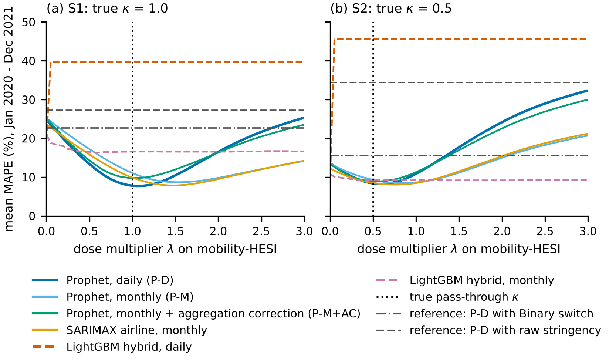

# Lockdowns as Partial Holidays

**Identifying work-stoppage elasticities from recurring holidays and transferring them to forecast Thailand's monthly exports through the COVID-19 shock**

Thanatchon Chongmankhong · 2026 · Preprint: [`paper/arxiv/main.pdf`](paper/arxiv/main.pdf)

> **Scope.** All quantitative results come from a Monte Carlo study in which export values are **simulated**. The Thai holiday calendar, the OxCGRT stringency indices and the Google Community Mobility data that drive the simulation are **real**. The code can be applied to official export statistics (see [Using official export data](#using-official-export-data)), but no such results are reported in the paper.

## Idea

A lockdown is treated as a *partial holiday*. Holidays that recur every year (Thai public holidays including Songkran, and the Chinese-New-Year window for the main trading partner) identify a work-stoppage elasticity through **one shared regressor per channel** in Prophet. During the pandemic the same regressor carries a **dose**, the Holiday-Equivalent Stoppage Index (HESI):

```
HESI_d = (drop in workplace mobility on day d) / (median drop on a weekday public holiday)
x_d    = H_d + (1 - H_d) * min(1, lambda * HESI_d)        H_d = 1 on public holidays
log y_d = trend + seasonality + beta * x_d + ...
```

Because `beta` is estimated on a decade of holidays, forecasting an unseen lockdown requires no new parameter, only the dose scale `lambda`.

## Main results (30 replications)

Daily Prophet, MAPE of monthly exports over January 2020 - December 2021 (scenario-conditional forecasts made in December 2019):

| Dose variant | S1: ideal transfer | S2: realistic |
|---|---:|---:|
| No COVID dose | 26.0% | 14.7% |
| Whole-month binary switch | 22.7% | 15.5% |
| Raw OxCGRT stringency | 27.2% | 34.4% |
| **HESI dose (lambda = 1)** | **7.8%** | 10.9% |
| Oracle dose (true pass-through) | 7.8% | 8.3% |

* In S1 the HESI gain is significant in every comparison (Wilcoxon, Holm-adjusted p < 0.001). In S2, where mobility overstates the true stoppage two-fold and a demand shock is present, the gain over no dose is **not** significant after Holm's correction; calibrating the dose on March-April 2020 is significantly better than the uncalibrated dose.
* Theory matches the simulation: monthly models attenuate the daily elasticity to about `exp(beta) - 1` (predicted -0.55, estimated -0.54), and the closed-form aggregation correction predicts -0.78 (s.d. 0.28) against -0.76 (0.27) observed.
* Tree ensembles cannot transfer a dose: LightGBM splits the stoppage feature at 1e-35, so any positive dose becomes a full holiday (MAPE about 40-46%).
* After the shock (2023-2024), SARIMAX (5.7%) and masking the shock window (6.1%) are as good as or better than HES. In normal times (2018-2019), daily LightGBM is the most accurate method (4.7%).



## Repository structure

```
.
├── src/
│   ├── hesi_forecast.py     calendar, HESI, data-generating process, models, experiments, `real` runner (CLI)
│   ├── figs_en.py           publication figures + automated check for overlapping text
│   ├── robust_en.py         robustness experiments R1 (heterogeneous holidays) and R2 (real-time HESI)
│   └── hesi_report.py       result tables and macros used by the paper build
├── scripts/build_arxiv.py   paired tests, theory checks and tables -> paper/arxiv/main.pdf
├── data/                    OxCGRT (Thailand, China) and Google Mobility (Thailand) extracts, see data/README.md
├── results/                 precomputed outputs of the 30-replication study
├── figures/                 the eight figures of the paper
├── paper/
│   ├── arxiv/               arXiv-ready source (main.tex, arxiv.sty, figures) and main.pdf
│   └── thai/                Thai-language draft (paper_th.tex, paper_th.pdf, Sarabun font)
├── prompts/research_prompt.md   instructions for an AI agent to replicate the study with official data
├── tests/                   unit tests (also run by GitHub Actions)
├── Makefile  requirements.txt  CITATION.cff  LICENSE
```

## Quick start

Requires Python 3.12. Building the papers also requires a TeX distribution (`pdflatex` for the arXiv version, `xelatex` for the Thai draft).

```bash
python -m venv .venv && source .venv/bin/activate
pip install -r requirements.txt
make test      # unit tests, about 10 s
make figures   # rebuild the 8 figures from results/ and check every figure for overlapping text
make paper     # rebuild paper/arxiv/main.pdf
make thai      # rebuild paper/thai/paper_th.pdf
```

Full reproduction from scratch:

```bash
make simulate  # 30 Monte Carlo replications, about 15 min on one CPU core
make robust    # robustness experiments, about 2 min
make figures paper
```

## Using official export data

Prepare a CSV whose first column is the month (`YYYY-MM`) and whose second column is the export value (for example USD million, preferably excluding gold), then run:

```bash
PYTHONPATH=src python src/hesi_forecast.py real --exports exports.csv --out results_real
```

The runner evaluates the monthly variants (no dose, binary, stringency, HESI, separate regressors, masking) together with SARIMAX and LightGBM at several forecast origins and writes `real_metrics.csv`, `real_forecasts.csv` and `real_coefficients.csv`. Forecasts from origins inside the pandemic use the observed drivers and are therefore scenario-conditional; report them separately from ex-ante forecasts. Use `--lam` to set the dose multiplier.

## Data sources

* Oxford COVID-19 Government Response Tracker (Hale et al., 2021).
* Google LLC, *Google COVID-19 Community Mobility Reports*.
* Thai and Chinese holiday calendars from the `holidays` Python package.

See [`data/README.md`](data/README.md) for files, provenance and terms of use.

## Citation

```bibtex
@misc{chongmankhong2026lockdowns,
  author = {Chongmankhong, Thanatchon},
  title  = {Lockdowns as Partial Holidays: Identifying Work-Stoppage Elasticities from Recurring Holidays
            and Transferring Them to Forecast {Thailand}'s Monthly Exports through the {COVID-19} Shock},
  year   = {2026},
  note   = {Preprint}
}
```

## License

Code is released under the MIT License (`LICENSE`). The paper text in `paper/` is © 2026 Thanatchon Chongmankhong. The Sarabun font is distributed under the SIL Open Font License (`paper/thai/fonts/OFL.txt`). Data files keep the terms of their original sources.

## สรุปภาษาไทย

โปรเจกต์นี้มองล็อกดาวน์เป็น "วันหยุดบางส่วน" โดยให้ Prophet เรียนรู้ผลของการหยุดงานจากวันหยุดที่เกิดซ้ำทุกปี ได้แก่สงกรานต์ วันหยุดราชการไทย และตรุษจีน ผ่านตัวแปรร่วมตัวเดียวต่อช่องทาง แล้วใส่ปริมาณการหยุดงานในช่วงโควิดด้วยดัชนี HESI ซึ่งคำนวณจากการลดลงของการเดินทางไปที่ทำงาน (Google Mobility) หารด้วยการลดลงในวันหยุดจริง ผลทั้งหมดมาจากการศึกษาแบบจำลองที่ใช้ปฏิทินและตัวขับเคลื่อนโควิดจริง แต่ตัวเลขส่งออกเป็นข้อมูลจำลอง หากต้องการใช้กับข้อมูลส่งออกจริงของไทย ให้ใช้คำสั่ง `real` ตามหัวข้อด้านบน ฉบับภาษาไทยอยู่ที่ `paper/thai/paper_th.pdf`
