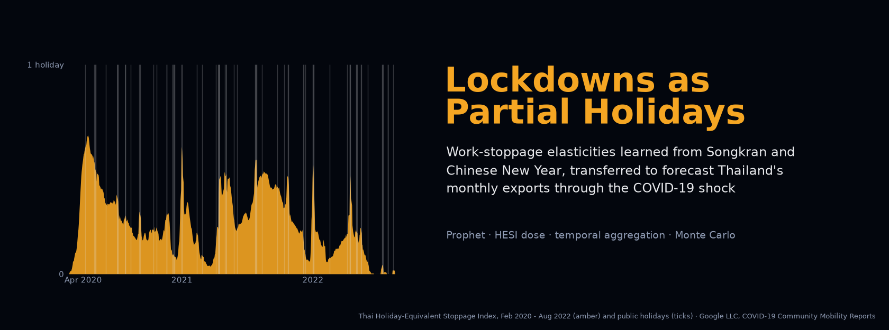

<p align="center"><a href="paper/paper.pdf"></a></p>

<p align="center">
<a href="https://github.com/thanatchon36/lockdowns-as-partial-holidays/actions/workflows/ci.yml"></a>
<a href="pyproject.toml"></a>
<a href="https://thanatchon36.github.io/lockdowns-as-partial-holidays/paper/"></a>
<a href="paper/paper.pdf"></a>
<a href="paper/thai/paper_th.pdf"></a>
<a href="docs/data_sources.md"></a>
<a href="LICENSE"></a>
<a href="https://zenodo.org/badge/latestdoi/1449353707"></a>
<a href="https://huggingface.co/datasets/thanatchon36/lockdowns-as-partial-holidays"></a>
<a href="https://huggingface.co/thanatchon36/lockdowns-as-partial-holidays"></a>
</p>

<p align="center">
📖 <b><a href="https://thanatchon36.github.io/lockdowns-as-partial-holidays/paper/">Read the paper online</a></b> ·
📄 <b><a href="paper/paper.pdf">Download the PDF</a></b> ·
🇹🇭 <b><a href="paper/thai/paper_th.pdf">ฉบับภาษาไทย</a></b> ·
🗂️ <b><a href="docs/data_sources.md">Data sources</a></b> ·
🤗 <b><a href="https://huggingface.co/datasets/thanatchon36/lockdowns-as-partial-holidays">Dataset</a></b> ·
🤖 <b><a href="prompts/research_prompt.md">Research prompt</a></b>
</p>

**A lockdown is a partial holiday.** Recurring holidays (Thai public holidays including Songkran, and the
Chinese New Year window for the main trading partner) identify a work-stoppage elasticity through **one shared
regressor per channel** in Prophet. During the pandemic the same regressor carries a **dose**, the
Holiday-Equivalent Stoppage Index (HESI), so forecasting an unseen lockdown needs no new parameter, only the
dose scale `lambda`. The repository holds the method, a 30-replication Monte Carlo study, robustness
experiments, theory checks and the paper.

```
HESI_d = (drop in workplace mobility on day d) / (median drop on a weekday public holiday)
x_d    = H_d + (1 - H_d) * min(1, lambda * HESI_d)        H_d = 1 on public holidays
log y_d = trend + seasonality + beta * x_d + ...
```

> **Simulated exports notice.** All quantitative results come from a Monte Carlo study in which export
> values are **simulated**. The Thai holiday calendar, the OxCGRT stringency indices and the Google
> Community Mobility data that drive the simulation are **real**. `hesi real` runs the same methods on
> official export statistics (see [Going from simulation to official data](#going-from-simulation-to-official-data)),
> but no such results are reported in the paper.

## Install and quickstart

```bash
make setup      # uv venv + dependencies (Python 3.12)
make test       # unit tests, about 10 s
make figures    # rebuild the 8 figures from results/ with the automated overlap check
make paper      # paper/paper.pdf and the web reader docs/paper/   (needs tectonic or pdflatex, and pandoc)
```

Full reproduction from scratch: `make all` (simulate + robust + figures + paper, about 17 minutes on one core).

| Target | Purpose |
|---|---|
| `setup` | Create `.venv` with uv and install the package with its pinned dependencies |
| `test` | Unit tests: calendar, shared regressors, Jensen bias, aggregation correction, Prophet linearity |
| `simulate` | Monte Carlo study, `REPS=30` (about 15 min on one core) → `results/` |
| `robust` | Robustness experiments R1 (heterogeneous holidays) and R2 (real-time HESI), about 2 min → `results/` |
| `figures` | The eight paper figures from `results/` → `paper/figures/`, with the automated overlap check |
| `paper` | `paper/template.tex` → `paper/paper.tex` → `paper/paper.pdf` (tectonic, or pdflatex), then `web` |
| `web` | Web reader only → `docs/paper/index.html`, served at <https://thanatchon36.github.io/lockdowns-as-partial-holidays/paper/> |
| `thai` | Thai draft → `paper/thai/paper_th.pdf` (tectonic, or xelatex) |
| `arxiv` | arXiv source bundle → `paper/arxiv.tar.gz` (prints title, abstract and comments for the form) |
| `banner` | README banner → `docs/assets/banner.png`, from the real Google Mobility data |
| `dataset` | Hugging Face dataset → `dist/hf_dataset/` (CSV only, with card, licence and checksums) |
| `model` | Hugging Face model repo → `dist/hf_model/`: refits the HES models of replication 0, saves them without pickle, reloads and checks them |

Every target is a thin wrapper around the `hesi` command (`hesi --help`), installed by `make setup`.

## Main results (30 replications)

Daily Prophet, MAPE of monthly exports over January 2020 - December 2021 (scenario-conditional forecasts made in
December 2019):

| Dose variant | S1: ideal transfer | S2: realistic |
|---|---:|---:|
| No COVID dose | 26.0% | 14.7% |
| Whole-month binary switch | 22.7% | 15.5% |
| Raw OxCGRT stringency | 27.2% | 34.4% |
| **HESI dose (lambda = 1)** | **7.8%** | 10.9% |
| Oracle dose (true pass-through) | 7.8% | 8.3% |

* In S1 the HESI gain is significant in every comparison (Wilcoxon, Holm-adjusted p < 0.001). In S2, where
  mobility overstates the true stoppage two-fold and a demand shock is present, the gain over no dose is **not**
  significant after Holm's correction; calibrating the dose on March-April 2020 is significantly better than the
  uncalibrated dose.
* Theory matches the simulation: monthly models attenuate the daily elasticity to about `exp(beta) - 1`
  (predicted -0.55, estimated -0.54), and the closed-form aggregation correction predicts -0.78 (s.d. 0.28)
  against -0.76 (0.27) observed.
* Tree ensembles cannot transfer a dose: LightGBM splits the stoppage feature at 1e-35, so any positive dose
  becomes a full holiday (MAPE about 40-46%).
* After the shock (2023-2024), SARIMAX (5.7%) and masking the shock window (6.1%) are as good as or better than
  HES. In normal times (2018-2019), daily LightGBM is the most accurate method (4.7%).

<p align="center"></p>

## What the pipeline does

1. **Calendar** (`hesi.forecast`): the *observed* Thai public holidays from the `holidays` package (Songkran 2020
   was postponed and replaced by substitute days in July and September) and an eight-day Chinese New Year window.
2. **Dose** (`hesi.forecast`): the HESI divides the workplace-mobility drop on each day by the median drop on a
   weekday public holiday; holiday days are removed before the 7-day smoothing so their dips do not leak into
   neighbours. China gets stylised stoppage episodes, because OxCGRT stringency is not a stoppage measure there.
3. **Data-generating process** (`hesi.forecast`): simulated daily exports with known elasticities, scenario S1
   (the dose is the true stoppage) and S2 (mobility overstates stoppage two-fold, plus a demand shock).
4. **Models** (`hesi.forecast`): seasonal naive, Prophet daily and monthly (with and without the aggregation
   correction), SARIMAX, LightGBM daily and monthly, each with the dose variants off, binary, stringency, HESI,
   calibrated HESI and oracle.
5. **Experiments**: E0 (normal times, 2018-2019), E1 (the shock, 2020-2021), E2 (after the shock, 2023-2024),
   robustness R1 and R2 (`hesi.robust`), paired Wilcoxon tests with Holm's correction and the theory checks
   (`hesi.paper_build`).
6. **Deliverables**: eight figures with an automated check for overlapping text (`hesi.figures`), the paper built
   from `paper/template.tex` where every table and in-text number is filled from `results/`, its web reader
   (`hesi.paper_web`), the arXiv bundle and the Thai draft.

## Research: *Lockdowns as Partial Holidays: Identifying Work-Stoppage Elasticities from Recurring Holidays and Transferring Them to Forecast Thailand's Monthly Exports through the COVID-19 Shock*

The preprint by Thanatchon Chongmankhong is in [`paper/`](paper/): a PDF in [`paper/paper.pdf`](paper/paper.pdf),
read online at <https://thanatchon36.github.io/lockdowns-as-partial-holidays/paper/>, and its source in
[`paper/template.tex`](paper/template.tex) (arXiv layout, [`paper/arxiv.sty`](paper/arxiv.sty)), which
`make paper` fills from `results/` into `paper/paper.tex`. `make arxiv` packs that file with its figures into
`paper/arxiv.tar.gz` and checks the bundle compiles on its own. The paper asks whether a work-stoppage elasticity
identified from recurring holidays can forecast exports during lockdowns that never occur in the estimation
sample, how sensitive the transfer is to the dose, what monthly data lose, and whether tree ensembles can do the same.

- Figures: [`paper/figures/`](paper/figures/) · Results: [`results/`](results/)
- Dataset on Hugging Face: [`thanatchon36/lockdowns-as-partial-holidays`](https://huggingface.co/datasets/thanatchon36/lockdowns-as-partial-holidays), with the daily drivers
  and shared regressors, the real OxCGRT and Google Mobility extracts, the simulated exports and forecast
  paths of replication 0, and all Monte Carlo results as CSV (`make dataset` builds it)
- Models on Hugging Face: [`thanatchon36/lockdowns-as-partial-holidays`](https://huggingface.co/thanatchon36/lockdowns-as-partial-holidays), the six fitted HES models
  of the shock experiment (replication 0, trained on simulated exports) with a standalone loader, no pickle
  (`make model` builds it)
- Thai-language draft: [`paper/thai/paper_th.pdf`](paper/thai/paper_th.pdf) (source `paper/thai/paper_th.tex`,
  Sarabun font)
- Research prompt for an AI agent to replicate the study with official data:
  [`prompts/research_prompt.md`](prompts/research_prompt.md)

## Repository layout

```
src/hesi/
  forecast.py               calendar, HESI, data-generating process, models, experiments E0-E2, `real` runner
  robust.py                 robustness experiments R1 (heterogeneous holidays) and R2 (real-time HESI)
  figures.py                publication figures + automated check for overlapping text
  report.py                 result tables and macros used by the paper build
  paper_build.py            paired tests, theory checks, tables -> paper.tex -> paper.pdf (tectonic / pdflatex)
  paper_web.py              web reader docs/paper/ (pandoc)
  cli.py                    hesi {simulate,robust,figures,paper,thai,web,real}
scripts/arxiv_bundle.py     arXiv source bundle
scripts/make_banner.py      README banner
scripts/export_hf_dataset.py  Hugging Face dataset; card and licence in docs/hf_dataset/
scripts/export_hf_model.py    Hugging Face model repo; card, licence and loader in docs/hf_model/
data/raw/                   OxCGRT (Thailand, China) and Google Mobility (Thailand) extracts
docs/data_sources.md        files, provenance and terms of use
docs/paper/                 web reader (GitHub Pages), built by `make web`
results/                    precomputed outputs of the 30-replication study
paper/                      template.tex, arxiv.sty, reader.html, figures/, paper.pdf
paper/thai/                 Thai-language draft (paper_th.tex, paper_th.pdf, Sarabun font)
prompts/research_prompt.md  instructions for an AI agent to replicate the study with official data
tests/                      unit tests (also run by GitHub Actions)
```

## Going from simulation to official data

1. Prepare a CSV whose first column is the month (`YYYY-MM`) and whose second column is the export value (for
   example USD million, preferably excluding gold).
2. Run the methods at several forecast origins:

   ```bash
   .venv/bin/hesi real --exports exports.csv --out results_real   # --lam sets the dose multiplier
   ```

   This evaluates the monthly variants (no dose, binary, stringency, HESI, separate regressors, masking) together
   with SARIMAX and LightGBM and writes `real_metrics.csv`, `real_forecasts.csv` and `real_coefficients.csv`.
3. Forecasts from origins inside the pandemic use the observed drivers and are therefore scenario-conditional;
   report them separately from ex-ante forecasts.

## Limitations

Simulated export values; a stylised China stoppage path instead of a measured one; the HESI assumes mobility
measures stoppage up to scale, which S2 shows can fail by a factor of two; 30 replications; monthly official
data can only identify the attenuated elasticity, so the aggregation correction relies on the closed form. See
the paper's discussion of threats to validity.

## Citation

See [`CITATION.cff`](CITATION.cff); each release is archived on Zenodo, concept DOI
[10.5281/zenodo.24036954](https://doi.org/10.5281/zenodo.24036954) (DOI badge above). Or:

```bibtex
@misc{chongmankhong2026lockdowns,
  author = {Chongmankhong, Thanatchon},
  title  = {Lockdowns as Partial Holidays: Identifying Work-Stoppage Elasticities from Recurring Holidays
            and Transferring Them to Forecast {Thailand}'s Monthly Exports through the {COVID-19} Shock},
  year   = {2026},
  note   = {Preprint},
  doi    = {10.5281/zenodo.24036954},
  url    = {https://thanatchon36.github.io/lockdowns-as-partial-holidays/paper/}
}
```

License: code under MIT ([`LICENSE`](LICENSE)). The paper text in `paper/` is © 2026 Thanatchon Chongmankhong.
The Sarabun font is under the SIL Open Font License (`paper/thai/fonts/OFL.txt`). Data files keep the terms of
their original sources.

## สรุปภาษาไทย

โปรเจกต์นี้มองล็อกดาวน์เป็น "วันหยุดบางส่วน" โดยให้ Prophet เรียนรู้ผลของการหยุดงานจากวันหยุดที่เกิดซ้ำทุกปี
ได้แก่สงกรานต์ วันหยุดราชการไทย และตรุษจีน ผ่านตัวแปรร่วมตัวเดียวต่อช่องทาง แล้วใส่ปริมาณการหยุดงานในช่วงโควิดด้วยดัชนี HESI
ซึ่งคำนวณจากการลดลงของการเดินทางไปที่ทำงาน (Google Mobility) หารด้วยการลดลงในวันหยุดจริง
ผลทั้งหมดมาจากการศึกษาแบบจำลองที่ใช้ปฏิทินและตัวขับเคลื่อนโควิดจริง แต่ตัวเลขส่งออกเป็นข้อมูลจำลอง
หากต้องการใช้กับข้อมูลส่งออกจริงของไทย ให้ใช้คำสั่ง `hesi real` ตามหัวข้อด้านบน ฉบับภาษาไทยอยู่ที่ `paper/thai/paper_th.pdf`
